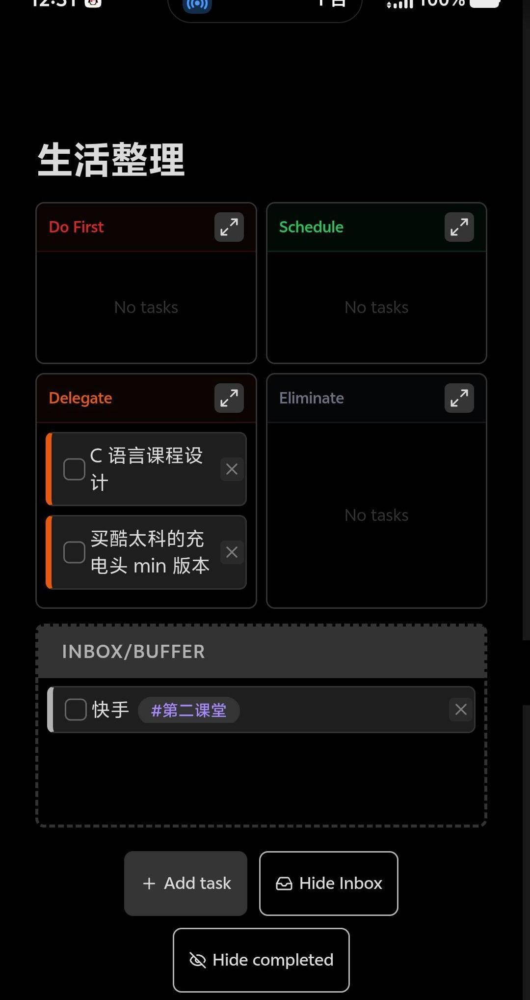
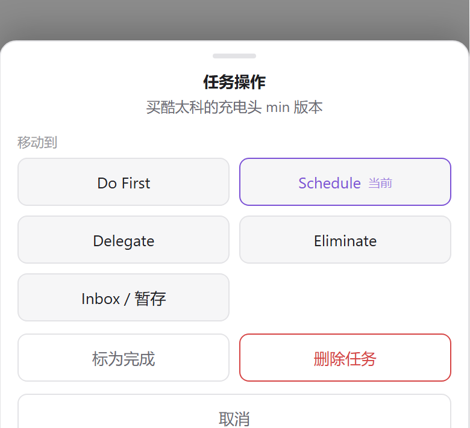

# QuadTasks Enhanced

把「艾森豪威尔四象限」做成一个代码块。任务本身还是笔记里的普通 markdown 勾选列表，四象限只是叠在上面的一层视图——所以它天然可读、可 diff、可同步。

> 本项目基于 [SiranHQ/obsidian-QuadTasks](https://github.com/SiranHQ/obsidian-QuadTasks)（MIT）修改，主要补充了：已完成任务显示/隐藏开关、移动端长按操作面板、Inbox 默认收起、以及移动端布局加固。插件 id 仍是 `quadtasks`，可以直接替换原版。



<sub>上图：四个象限 + 展开的 Inbox + 底部按钮（`Add task` / `Hide Inbox` / `Hide completed`）。</sub>

## 特性

| 能力 | 说明 |
|---|---|
| 纯 markdown 存储 | 任务写在代码块里，`- [ ] (象限) 内容`，不进 data.json |
| 四象限 + Inbox | Do First / Schedule / Delegate / Eliminate，另加一个「暂存区」接住还没想好的事 |
| 拖拽换象限 | 桌面端直接拖；触屏用长按 |
| 长按操作面板 | 长按 450ms 弹出底部面板：移到任意象限、标为完成、删除，一次点到位 |
| 右键同款面板 | 桌面端不想拖的时候右键即可 |
| 收起已完成 | 默认不显示 `[x]`，点一下全部展开，**过滤只在渲染层，文件里一行都不少** |
| Inbox 默认收起 | 底部显示 `Inbox (n)`，有暂存才提醒，不占版面 |
| 单象限聚焦 | 每个象限右上角的 ↗ 把它放大到整行 |
| 移动端适配 | 布局约束走内联 `!important`，不受主题和 Obsidian 默认 `ul` 内边距影响 |

## 安装

### 手动安装（推荐）

1. 到 [Releases](https://github.com/dongyue12/obsidian-quadtasks-enhanced/releases) 下载最新一版的 `main.js`、`manifest.json`、`styles.css`；
2. 放进 `<你的库>/.obsidian/plugins/quadtasks/`；
3. 重载 Obsidian（`Ctrl+R`），到 设置 → 第三方插件 里启用 **QuadTasks Enhanced**。

> 文件夹名必须是 `quadtasks`，要和 `manifest.json` 里的 `id` 一致，否则 Obsidian 不会加载。如果你之前装过原版 QuadTasks，直接覆盖这三个文件即可，笔记格式完全兼容。

## 用法

在笔记里插入一个 `eisenhower` 代码块（`eisen`、`todoeh` 是同义词）：

````markdown
```eisenhower
- [ ] (urgent-important) 交课程设计报告
- [ ] (not-urgent-important) 买充电头
- [ ] (urgent-not-important) 回复群里的通知
- [x] (not-urgent-important) 备份笔记
- [ ] (buffer) 快手 #第二课堂
```
````

五个分组标记：

| 标记 | 落在哪里 | 含义 |
|---|---|---|
| `urgent-important` | Do First | 紧急且重要 |
| `not-urgent-important` | Schedule | 重要不紧急 |
| `urgent-not-important` | Delegate | 紧急不重要 |
| `not-urgent-not-important` | Eliminate | 都不沾 |
| `buffer` | Inbox | 还没想好，先扔这儿 |

任务正文就是普通 markdown，`**加粗**`、`[[双链]]`、`#标签` 都能正常渲染。

### 底部按钮

```
[+ Add task]  [Inbox (2)]  [Completed (1)]  [Clear completed]
```

- **Add task**：弹窗新建，可选优先级、可带日期。
- **Inbox (n)**：展开/收起暂存区，`n` 是里面的任务数。
- **Completed (n)**：在「只显示未完成」和「全部显示」之间切换。**它只影响显示**，取消勾选、改文字都会立刻写回文件。
- **Clear completed**：⚠️ 真的从文件里删掉已完成的行，不归档、不提示。想留痕请先手动归档，或者干脆别点，用上面的开关把它们藏起来就够了。

### 移动端



触屏上没有 hover，也用不了 HTML5 拖拽，所以：**长按任务卡片 450ms** 弹出底部面板。

- 面板里五个去向一键切换，当前所在象限会标「当前」；
- 手指移动超过 10px 视为滑动，不会误弹；
- 长按后浏览器补发的 click 会被吃掉，不会误勾选旁边的复选框；
- 右上角的删除 × 在触屏上常显（半透明），不用悬停也能点。

## 和同步插件一起用

因为任务就是笔记正文的一部分，用 git 同步（vault-sync-git、obsidian-git 等）时按普通笔记同步即可，不会出现「插件数据没同步、任务丢了」的情况。手机和桌面同时开着同一个 `待办.md`，改哪边都行。

## 与上游的差异

- 新增 `Completed (n)` 显示开关（原版只能靠 `Clear completed` 全清）。
- 新增触屏长按面板、桌面右键面板。
- Inbox 默认收起，有内容时按钮显示计数。
- 布局加固：`li` / `p` / `ul` 的关键尺寸写成内联 `!important`，解决移动端「一个字一行」的竖排、卡片右侧被象限裁掉的问题。
- 移动端压缩内边距、字号、复选框与删除按钮尺寸。

## 已知限制

- **Clear completed 不归档**：这是上游行为，没有回收站，点了就没了。
- 触屏不支持拖拽换象限（用长按面板代替）。
- 界面文案是英文（Do First / Schedule / Delegate / Eliminate），和上游保持一致。
- 没有构建步骤：仓库里的 `main.js` 就是可直接加载的产物，改完源码不需要编译。

## 开发

```bash
git clone git@github.com:dongyue12/obsidian-quadtasks-enhanced.git
# 把整个目录软链或复制到 <vault>/.obsidian/plugins/quadtasks/
# 改完 main.js / styles.css，Obsidian 里 Ctrl+R 重载
```

`node --check main.js` 可以快速校验语法。

## 许可

MIT。原始版权归 Parth Sidpara（[QuadTasks](https://github.com/SiranHQ/obsidian-QuadTasks)），修改部分归 dongyue12。详见 [LICENSE](LICENSE)。

---

## English

QuadTasks Enhanced renders an Eisenhower matrix from a fenced `eisenhower` code block. Tasks stay as plain markdown checklists (`- [ ] (quadrant) text`) inside your note, so they diff, sync and survive tool changes.

Compared to upstream QuadTasks it adds a **show/hide completed toggle** (rendering-only, nothing is deleted), a **long-press action sheet** for touch devices plus right-click on desktop, a **collapsed Inbox**, and hardened mobile layout written as inline `!important` rules so themes cannot squeeze task text into one character per line.

Install: drop `main.js`, `manifest.json`, `styles.css` into `<vault>/.obsidian/plugins/quadtasks/`, reload Obsidian, enable the plugin. Plugin id stays `quadtasks` — a drop-in replacement for the original. MIT licensed.
